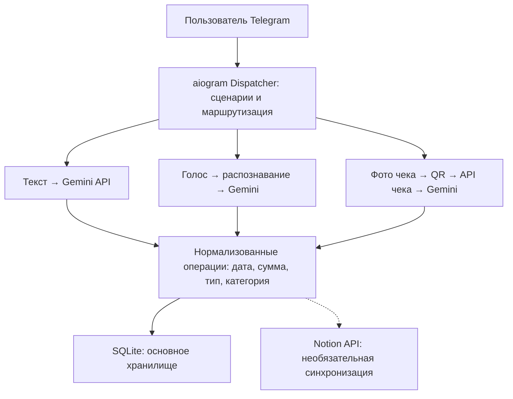

# MONYTOR
## Интеллектуальный Telegram-бот для учёта личных финансов

**Подробный технический отчёт (write-up)**

**Дата отчёта:** 31.10.2026  
**Язык отчёта:** русский

Обработка естественного языка, голосовых сообщений и QR-кодов кассовых чеков с сохранением финансовых операций и синхронизацией с Notion.

| Паспорт проекта | Сведения |
| --- | --- |
| Год реализации | 2026 |
| Публичная точка входа | https://t.me/monytorobot |
| Роль участника | Разработчик прикладной логики бота, базы данных и внешних интеграций |
| Технологии | Python, aiogram 3, SQLite / aiosqlite, Gemini API, SpeechRecognition, httpx, Notion API, Pillow, pyzbar, pydub |
| Описываемая редакция | main18_modified.py, дата изменения 22.06.2026 |
| Языки интерфейса | Русский, английский, арабский |

MONYTOR переносит повседневный учёт расходов и доходов в привычный интерфейс Telegram. Пользователь описывает операцию обычными словами, отправляет голосовое сообщение или фотографию кассового чека. Система преобразует ввод в структурированные записи и предоставляет историю и помесячные итоги.

**Открыть проект:** [t.me/monytorobot](https://t.me/monytorobot)

Документ описывает реализацию по исходному коду указанной редакции. Примеры операций являются синтетическими; секреты доступа и персональные финансовые записи не публикуются.

## Содержание

- [1. Аннотация, цель и вклад участника](#1-аннотация-цель-и-вклад-участника)
- [2. Функциональные возможности и сценарии](#2-функциональные-возможности-и-сценарии)
- [3. Архитектура и технологический стек](#3-архитектура-и-технологический-стек)
- [4. Модель данных и организация хранения](#4-модель-данных-и-организация-хранения)
- [5. Регистрация, локализация и профиль](#5-регистрация-локализация-и-профиль)
- [6. Извлечение операций из текста с Gemini](#6-извлечение-операций-из-текста-с-gemini)
- [7. Голосовой ввод и единый конвейер](#7-голосовой-ввод-и-единый-конвейер)
- [8. Обработка фотографий кассовых чеков](#8-обработка-фотографий-кассовых-чеков)
- [9. Интеграция с Notion и синхронизация](#9-интеграция-с-notion-и-синхронизация)
- [10. История, статистика и удаление операций](#10-история-статистика-и-удаление-операций)
- [11. Организация кода, асинхронность и ошибки](#11-организация-кода-асинхронность-и-ошибки)
- [12. Доступ к данным, безопасность и надёжность](#12-доступ-к-данным-безопасность-и-надёжность)
- [13. Локальная верификация и результаты](#13-локальная-верификация-и-результаты)
- [14. Сложность, ограничения и развитие](#14-сложность-ограничения-и-развитие)
- [15. Версии, запуск и практический результат](#15-версии-запуск-и-практический-результат)
- [А. Перечень локальных контрольных проверок](#а-перечень-локальных-контрольных-проверок)

### Как читать документ

Сначала рассматриваются задача проекта и пользовательские сценарии, затем архитектура, данные и реализация подсистем. Последние разделы посвящены локальной верификации, ограничениям и воспроизводимости. Приложение содержит полный перечень выполненных проверок.

Названия функций соответствуют main18_modified.py. Фрагменты с пометкой «упрощённо» поясняют алгоритмы и не заменяют полный исходный файл. Возможности внешних сервисов рассматриваются в пределах их использования в коде проекта.

## 1. Аннотация, цель и вклад участника

### 1.1. Актуальность задачи

При ручном учёте личных финансов пользователь должен не только помнить о каждой покупке, но и регулярно открывать отдельное приложение, выбирать категорию и вводить сумму. Чем больше действий требуется для записи, тем выше вероятность пропусков. Дополнительная трудность возникает при работе с кассовыми чеками: один документ может содержать много позиций, которые неудобно переписывать вручную.

MONYTOR решает задачу снижения трудоёмкости ввода. Пользователь общается с ботом в Telegram, а преобразование свободного текста в поля операции выполняет языковая модель. Голосовой ввод и чтение QR-кодов дополняют текстовый сценарий. SQLite обеспечивает локальное хранение, поэтому подключение Notion остаётся дополнительной возможностью, а не обязательным условием ведения учёта.

### 1.2. Цель и задачи разработки

**Цель проекта** - разработать Telegram-бота, который преобразует повседневные сообщения пользователя в структурированный журнал доходов и расходов и предоставляет удобный доступ к истории операций.

- Реализовать регистрацию пользователя, выбор языка и базовой валюты учёта.
- Объединить текстовый, голосовой и чековый ввод в единый формат финансовой операции.
- Интегрировать языковую модель для извлечения суммы, даты, типа, категории и описания.
- Организовать хранение данных, просмотр по месяцам, агрегирование и удаление записей.
- Добавить необязательное подключение Notion и синхронизацию ранее сохранённых операций.

### 1.3. Роль участника

Роль участника - разработчик программной части проекта. Вклад включает проектирование структуры данных и пользовательских сценариев, реализацию обработчиков Telegram на Python/aiogram, интеграцию Gemini API и сервиса проверки чеков, организацию голосового ввода, разработку операций с SQLite и интеграции с Notion. Отдельное внимание уделено согласованию разных источников ввода с единым форматом записи и многоязычным интерфейсом.

В проекте применяется готовая языковая модель через API. Собственная модель машинного обучения не обучается; инженерный результат состоит в построении прикладной системы и контракта взаимодействия между её компонентами.

## 2. Функциональные возможности и сценарии

| Возможность | Поведение в описываемой редакции |
| --- | --- |
| Текстовый ввод | Из одного сообщения извлекается одна или несколько финансовых операций. |
| Голосовой ввод | OGG преобразуется в WAV, речь распознаётся, полученный текст передаётся в Gemini. |
| Фотография чека | На изображении ищется QR-код; по его содержимому запрашиваются позиции кассового чека. |
| Категоризация | Используется фиксированный справочник из 42 категорий и два типа: доход и расход. |
| Локальное хранение | Профили и операции сохраняются в SQLite независимо от подключения Notion. |
| История | Операции выбираются по пользователю и календарному месяцу. |
| Статистика | Суммы доходов и расходов агрегируются отдельно по категориям за месяц. |
| Удаление | Пользователь выбирает запись из 30 последних операций; принадлежность проверяется по user_id. |
| Notion | Создаются страницы операций, сохраняется их внешний ID, поддерживается досылка старых записей. |
| Языки и валюта | Интерфейс на русском, английском и арабском; название валюты задаётся в профиле. |
| Перепривязка аккаунта | Секретный токен позволяет связать существующий внутренний профиль с Telegram ID. |

### 2.1. Основной пользовательский сценарий

После команды /start новый пользователь выбирает язык, указывает валюту и создаёт новый профиль либо вводит токен существующего. Главное меню предоставляет историю, статистику, настройку Notion и удаление. Обычное текстовое сообщение, не совпавшее с кнопками меню, интерпретируется как описание финансовой операции.

Например, сообщение «Купил продукты за 850 рублей» содержит сумму, описание и семантику расхода. Модель преобразует его в структурированную запись, а приложение добавляет дату, связывает запись с владельцем и сохраняет её. Это иллюстрация сценария; приведённый пример не является результатом отдельного вызова модели при подготовке отчёта.

### 2.2. Границы возможностей

Название валюты хранится в профиле; автоматическая конвертация между валютами не реализована. Обработка QR-кодов кассовых чеков разрешена для профиля с валютой Russian Ruble. Аналитика представляет собой помесячные суммы по категориям. Прогнозирование расходов, подключение банковских счетов и финансовые рекомендации в эту редакцию не входят.

## 3. Архитектура и технологический стек

Приложение построено как асинхронный Telegram-бот с длительным опросом обновлений (polling). Физически основная логика находится в одном файле, однако её можно разделить на интерфейсный слой, обработку данных, доступ к SQLite и адаптеры внешних API. На схеме показаны именно логические компоненты, а не отдельные развернутые микросервисы.



> Рисунок 1. Три канала ввода приводятся к общей записи. SQLite - основное хранилище; пунктир обозначает необязательную передачу в Notion.

| Компонент | Назначение |
| --- | --- |
| aiogram 3 / asyncio | Маршрутизация Telegram-событий, клавиатуры, callback-запросы и асинхронные сценарии. |
| httpx / Gemini API | Асинхронные HTTP-запросы к модели для извлечения и категоризации операций. |
| aiosqlite / SQLite | Хранение пользователей и транзакций в локальной реляционной базе. |
| SpeechRecognition / pydub | Преобразование аудио и распознавание речи перед обработкой текста. |
| Pillow / pyzbar | Чтение изображения чека и декодирование QR-кода. |
| Notion API / API проверки чека | Синхронизация журнала и получение позиций фискального документа. |

## 4. Модель данных и организация хранения

Используются две основные сущности: пользователь и финансовая операция. У пользователя есть внутренний первичный ключ id, а внешний telegram_id связывает профиль с Telegram. Все операции ссылаются на внутренний user_id; благодаря этому перепривязка Telegram ID не требует переноса строк журнала.

### 4.1. Таблица users

| Поле | Тип / назначение |
| --- | --- |
| id | INTEGER PRIMARY KEY AUTOINCREMENT; внутренний идентификатор. |
| telegram_id | INTEGER UNIQUE; идентификатор Telegram, допускает NULL при перепривязке. |
| language / currency | TEXT; язык интерфейса и выбранная пользователем валюта. |
| token | TEXT UNIQUE NOT NULL; секретный код привязки профиля. |
| notion_api_key / notion_database_id | TEXT; необязательные параметры личной интеграции с Notion. |
| created_at | TIMESTAMP; время создания профиля. |

### 4.2. Таблица transactions

| Поле | Тип / назначение |
| --- | --- |
| id / user_id | INTEGER; первичный ключ операции и ссылка на владельца. |
| date / amount | TEXT в формате YYYY-MM-DD; REAL для суммы. |
| type / category | TEXT; внутренний тип операции и категория из справочника. |
| description | TEXT; краткое описание на выбранном языке пользователя. |
| receipt_id / photo_file_id | TEXT; идентификатор группы ввода и файл Telegram при вводе по чеку. |
| notion_page_id | TEXT; ID созданной страницы Notion, если синхронизация выполнена. |
| created_at | TIMESTAMP; время добавления строки в SQLite. |

### 4.3. Совместимость с предыдущими данными

В init_db() выполняется CREATE TABLE IF NOT EXISTS, затем проверяется состав столбцов transactions через PRAGMA table_info. Если notion_page_id отсутствует в старой базе, он добавляется через ALTER TABLE. Эта миграция позволяет подключить отслеживание синхронизации к ранее созданному журналу.

Внешний ключ объявлен в схеме. Для промышленной эксплуатации его принудительное соблюдение следует явно включать для каждого SQLite-соединения. Для точного денежного учёта целесообразен переход от REAL к целым минимальным денежным единицам или Decimal.

## 5. Регистрация, локализация и профиль

### 5.1. Пошаговое подключение пользователя

| Состояние | Действие и результат |
| --- | --- |
| /start | Поиск профиля по telegram_id. Если он существует, сразу открывается главное меню. |
| language | Inline-кнопки выбора ar, ru или en; выбранный код временно сохраняется. |
| currency | Название валюты интерпретируется через Gemini; при неудаче используется введённое значение. |
| account_type | Выбор создания нового профиля или существующего аккаунта. |
| Новый аккаунт | secrets.token_hex(6) создаёт секретный токен; профиль сохраняется в users. |
| enter_token | По токену находится внутренний профиль, после чего выполняется перепривязка Telegram ID. |
| Главное меню | Профиль кэшируется; временное состояние регистрации удаляется. |

### 5.2. Состояния и кэш

Словари user_onboarding, user_temp_data и user_cache хранят состояние диалога, промежуточные ответы и часто используемые поля профиля. Фильтры aiogram выбирают обработчик с учётом текущего этапа. Временные данные упрощают сценарий регистрации без отдельного графического приложения. Они находятся в памяти процесса и не восстанавливаются после перезапуска.

### 5.3. Единый внутренний справочник

Типы и категории хранятся в каноническом представлении, а translate_type() и translate_category() преобразуют их для интерфейса и Notion. Это отделяет аналитическое значение категории от языка отображения. Функция get_text() получает шаблон из MESSAGES и подставляет параметры. Для отсутствующего языка предусмотрен резервный английский вариант.

### 5.4. Перепривязка по секретному коду

При вводе существующего токена сохраняется внутренний id пользователя, а его telegram_id меняется. Если новый Telegram ID уже связан с другой строкой, прежняя связь освобождается. Этот механизм реализует перенос привязки профиля. В рассматриваемой редакции он не является системой одновременного семейного доступа или многофакторной аутентификацией.

## 6. Извлечение операций из текста с Gemini

### 6.1. Постановка задачи модели

Обработчик handle_transaction() передаёт обычное сообщение в call_gemini(). Системная инструкция задаёт дату отсчёта, язык описания, допустимые категории и формат ответа. Модель должна вернуть JSON с массивом items; каждый элемент описывает одну финансовую операцию. Поэтому сообщение с несколькими покупками может быть преобразовано в несколько строк журнала.

| Поле результата | Ожидаемый смысл |
| --- | --- |
| date | Дата операции YYYY-MM-DD; при отсутствии явной даты используется дата сообщения. |
| amount | Положительная числовая сумма; это требование задано в инструкции модели. |
| type / category | Канонический тип дохода/расхода и значение из справочника 42 категорий. |
| description | Краткое описание на языке профиля. |
| receipt_id | UUID, присвоенный вводу приложением, а не придуманный моделью. |

### 6.2. Контракт запроса и постобработка

```python
payload = {
    "system_instruction": {"parts": [{"text": system_prompt}]},
    "contents": [{"parts": [{"text": user_text}]}],
    "generation_config": {
        "response_mime_type": "application/json",
        "temperature": 0.0,
    },
}
```

Ответ извлекается из candidates, content и parts. Программа убирает Markdown-ограждения, выполняет json.loads(), проверяет, что items является списком, и дополняет недостающие date и receipt_id. Неизвестные типы и категории заменяются резервными значениями. Это мягкая нормализация ответа; полноценная проверка схемы, числовых диапазонов и дат остаётся направлением улучшения.

### 6.3. Несколько попыток обращения

Функция последовательно перебирает настроенные ключи. Для каждого запроса установлен тайм-аут 30 секунд; при HTTP 429 выполняется короткая задержка. Ошибка HTTP, отсутствие содержимого или некорректный JSON приводят к следующей попытке. После исчерпания попыток исключение обрабатывается пользовательским сценарием. Число ключей само по себе не гарантирует независимость квот внешнего сервиса.

## 7. Голосовой ввод и единый конвейер

Голосовой сценарий повторно использует ту же модель финансовой операции, что и текстовый. Пользователь отправляет голосовое сообщение Telegram; бот загружает файл, распознаёт речь, показывает текст и передаёт его в call_gemini(). Отдельная логика категоризации для аудио не требуется.

### 7.1. Этапы обработки

| Этап | Реализация |
| --- | --- |
| Загрузка | По voice.file_id запрашивается путь и содержимое файла через Telegram Bot API. |
| Преобразование | pydub.AudioSegment читает OGG из памяти и экспортирует WAV в BytesIO. |
| Распознавание | SpeechRecognition вызывает recognize_google с языковым кодом профиля. |
| Разгрузка event loop | Блокирующий вызов распознавания выполняется через asyncio.to_thread(). |
| Структурирование | Распознанный текст, дата сообщения и язык передаются в call_gemini(). |
| Сохранение | Операции записываются в SQLite; при настройке интеграции создаются страницы Notion. |

### 7.2. Ключевой фрагмент

```python
wav_io = BytesIO()
audio.export(wav_io, format="wav")
wav_io.seek(0)
recognizer = sr.Recognizer()
with sr.AudioFile(wav_io) as source:
    audio_data = recognizer.record(source)
text = await asyncio.to_thread(
    recognizer.recognize_google,
    audio_data,
    language=language,
)
```

Здесь две независимые внешние задачи: распознавание речи и извлечение финансовых сущностей. Корректная транскрипция ещё не гарантирует корректность сумм и категорий. Для оценки качества следует отдельно измерять ошибки распознавания речи и ошибки структурирования.

### 7.3. Ошибки и ограничения

Обрабатываются повреждённое аудио, отсутствие распознанной речи и недоступность сервиса. Предусмотрены русская, английская и арабская локализации; распознавание конкретного диалекта или акцента требует отдельной проверки. Конвертация аудио и часть локальных операций остаются синхронными, что важно учитывать при росте нагрузки.

## 8. Обработка фотографий кассовых чеков

### 8.1. Получение данных по QR-коду

Сценарий handle_receipt_photo() работает с фотографией фискального чека. Программа выбирает самое крупное доступное изображение Telegram, загружает его в память, открывает через Pillow и декодирует QR-код с помощью pyzbar. Содержимое QR передаётся в API проверки чека, который возвращает позиции документа.

Это получение структурированных данных по QR-коду, а не распознавание напечатанного текста с помощью OCR. Если QR-код не найден, пользователь получает соответствующее сообщение. Если валюта профиля отличается от Russian Ruble, обработчик сообщает об ограничении сценария.

### 8.2. Нормализация позиций

```python
inner = data.get("data", {}).get("json", {})
items = inner.get("items", [])
for item in items:
    if "price" in item:
        item["price"] = item["price"] / 100
    if "sum" in item:
        item["sum"] = item["sum"] / 100
date_str = inner.get("dateTime")
```

Стоимость переводится из копеек в рубли. Для каждой позиции формируется строка с названием, ценой и количеством. В описываемой редакции итог позиции вычисляется как price × quantity. Затем список передаётся модели для распределения по категориям. Дата берётся из чека; если она отсутствует, используется дата сообщения.

### 8.3. Связь с исходным документом

Для обработанного ввода создаётся UUID receipt_id. Он связывает операции одного чека. Дополнительно хранится photo_file_id, связывающий запись с фотографией в Telegram. Каждая операция сохраняется отдельно, поэтому доступны последующие просмотр, агрегирование и удаление.

### 8.4. Обработка ошибок

Отдельно учитываются отсутствие QR-кода, ошибка HTTP, неожиданный код ответа сервиса, пустой список товаров и ошибка модели. Для расширения сценария полезны защита от повторного импорта чека, сверка суммы с учётом скидок и отдельный путь для документов без QR-кода.

## 9. Интеграция с Notion и синхронизация

Notion является дополнительным представлением финансового журнала. Пользователь вводит ключ своей интеграции и ID базы. normalize_notion_database_id() принимает как UUID, так и ссылку с параметрами и приводит найденный 32-значный идентификатор к формату с дефисами.

### 9.1. Отображение полей

| Свойство Notion | Источник значения |
| --- | --- |
| Name / Description | Краткое описание операции на языке пользователя. |
| Date / Amount | Дата и числовая сумма. |
| Type / Category | Переведённые для интерфейса тип и категория. |
| Receipt ID | Идентификатор группы ввода. |
| Photo | Необязательное внешнее вложение при обработке фотографии чека. |

add_to_notion_if_configured() проверяет наличие параметров интеграции, формирует запрос создания страницы и возвращает её ID. Он сохраняется в notion_page_id локальной операции. Отсутствие Notion-настроек не мешает сохранению в SQLite.

### 9.2. Синхронизация существующих записей

```python
records = await get_all_transactions_for_user(user["id"])
synced_count = 0
for rec in records:
    if rec.get("notion_page_id"):
        continue
    page_id = await add_to_notion_if_configured(
        user, rec, rec.get("photo_file_id")
    )
    if page_id:
        await update_transaction_notion_page_id(rec["id"], page_id)
        synced_count += 1
```

Сохранённый внешний ID позволяет пропускать записи при повторном запуске синхронизации. Это снижает число повторов в штатном сценарии. Между успешным созданием внешней страницы и локальным сохранением ID остаётся окно сбоя; полноценная идемпотентность требует дополнительного механизма.

### 9.3. Удаление и согласованность

При удалении бот сначала пытается архивировать связанную страницу Notion, затем удаляет локальную строку с проверкой владельца. Результат внешнего архивирования не блокирует локальное удаление. Распределённая атомарность между SQLite и Notion не обеспечивается; для усиления согласованности целесообразны очередь повторов и журнал статусов синхронизации.

## 10. История, статистика и удаление операций

### 10.1. Выборка календарного месяца

Список доступных месяцев строится из дат операций пользователя. Для выбранного месяца query_transactions() вычисляет начало текущего и следующего месяца и использует полуоткрытый интервал [start_date, end_date). Это включает последний день месяца и отделяет записи следующего периода, в том числе при переходе с декабря на январь.

```sql
SELECT id, user_id, date, amount, type, category,
       description, receipt_id, photo_file_id,
       created_at, notion_page_id
FROM transactions
WHERE user_id = ? AND date >= ? AND date < ?
ORDER BY date ASC
```

Формат YYYY-MM-DD позволяет сравнивать корректные даты как строки. Для строки месяца, не разбираемой как два целых числа, функция возвращает пустую выборку. Полная календарная валидация чисел месяца и дат операций требует усиления.

### 10.2. Формирование истории и итогов

История выводит описание, категорию, сумму, тип и дату. При длинном результате текст делится на части до 4000 символов. Статистика обходит выбранные записи и накапливает две таблицы сумм: отдельно для доходов и расходов. Затем категории переводятся на язык профиля и выводятся с общими итогами.

```python
for rec in records:
    target = income_by_cat if is_income(rec) else expense_by_cat
    category = rec["category"]
    target[category] = target.get(category, 0) + rec["amount"]
```

> Упрощённая схема агрегирования. is_income() обозначает проверку канонического типа; в исходном обработчике используется непосредственное сравнение строки.

### 10.3. Удаление с проверкой владельца

Для выбора доступны 30 последних операций. Callback содержит ID операции, однако право на удаление определяется запросом WHERE user_id=? AND id=?. Сначала извлекается запись текущего пользователя, затем выполняются внешнее архивирование и локальное удаление. Попытка получить или удалить чужую запись по её ID не находит подходящую строку.

## 11. Организация кода, асинхронность и ошибки

| Логическая группа | Ключевые функции |
| --- | --- |
| Локализация | translate_category, translate_type, get_language_name, get_text |
| Профиль и настройки | get_user, create_user, update_user_token, get_user_by_token, update_user_notion |
| Хранилище операций | save_transaction, row_to_transaction, query_transactions, get_transaction_by_id, delete_transaction_by_id |
| Модель и ввод | call_gemini, parse_currency_with_gemini, transcribe_voice, decode_qr_from_image |
| Фискальные документы | fetch_check_via_qrraw, extract_products_from_check_data |
| Notion | build_notion_properties, add_to_notion_if_configured, sync_user_transactions_to_notion, delete_from_notion_if_possible |
| Пользовательский интерфейс | start, language_chosen, account_choice, unified_text_handler, handle_transaction, handle_receipt_photo, handle_voice_message |
| Отчёты и запуск | show_history, show_statistics, delete_transaction_callback, main |

### 11.1. Неблокирующие операции

HTTP-запросы выполняются через httpx.AsyncClient, а работа с базой оформлена через aiosqlite. Обработчики aiogram используют async/await. Для блокирующего распознавания речи применяется asyncio.to_thread(). При этом декодирование изображений и часть аудиопреобразования выполняются синхронно; асинхронная структура не означает отсутствия всех возможных блокировок event loop.

### 11.2. Отказы внешних компонентов

Внешние интеграции имеют локальную обработку исключений и тайм-ауты. Ошибка Notion не отменяет выполненное локальное сохранение. При ошибке Gemini бот сообщает об отсутствии результата; в чековом сценарии раздельно обрабатываются получение позиций и их разбор. Это помогает локализовать источник сбоя, хотя общей очереди повторов и транзакции на несколько внешних систем пока нет.

### 11.3. Сопровождение

Описываемая редакция содержит 51 функцию в основном файле. При дальнейшем развитии естественно выделить модули обработчиков, сервиса модели, репозитория данных и внешних интеграций. Это улучшит изолированное тестирование и позволит менять поставщика модели без переписывания пользовательских сценариев.

## 12. Доступ к данным, безопасность и надёжность

### 12.1. Реализованные механизмы

- SQL-запросы передают пользовательские значения через параметры, а не соединяют их со строкой SQL.
- Выборка отдельной операции и удаление ограничены внутренним user_id текущего профиля.
- Токен привязки генерируется через модуль secrets; ключи и токены рассматриваются как конфиденциальные данные.
- Для HTTP-запросов заданы тайм-ауты; отказ интеграции Notion отделён от локального учёта.

### 12.2. Данные и границы доверия

Текст операции и распознанная речь передаются во внешний сервис модели. Аудио обрабатывается сервисом распознавания, а данные QR-кода - сервисом проверки чека. При включённом Notion операции передаются и туда. Для реальной эксплуатации важны понятное уведомление пользователя, минимизация передаваемых данных и правила удаления информации.

В архивной редакции ключи внешних сервисов заданы в исходном файле, а индивидуальные параметры Notion находятся в users. Для распространения исходников секреты следует вынести в окружение; при эксплуатации предусмотреть управление секретами и ограничение доступа к файлу базы. Отчёт не содержит значения ключей, токены пользователей и содержимое реальных операций.

### 12.3. Приоритетные улучшения

| Область | Направление усиления |
| --- | --- |
| Перепривязка профиля | Ограничение попыток ввода токена, срок действия и корректный отзыв закэшированных привязок. |
| Денежные значения | Целые копейки или Decimal, проверка диапазонов и обязательности полей. |
| Вложения Notion | Безопасные ссылки на фото без включения секретов Telegram-бота. |
| Восстановление после сбоев | Очередь синхронизации, повторные попытки и резервные копии SQLite. |
| Большие входные данные | Лимиты размера изображений, длительности аудио и объёма ответа модели. |

Наличие параметризованных запросов не заменяет полноценный аудит безопасности. В этом разделе разделены уже реализованные проверки и дальнейшие меры; отсутствие последних не скрывается за общими заявлениями о защищённости.

## 13. Локальная верификация и результаты

При подготовке отчёта выполнено **37 контрольных проверок**. Проверялись функции из main18_modified.py без изменения их логики. Для доступа к временной SQLite использовался небольшой асинхронный тестовый адаптер, а ответы HTTP-сервисов имитировались. Исходная база проекта не изменялась; реальные ключи доступа и сетевые запросы не использовались.

| Группа | Проверок | Результат |
| --- | --- | --- |
| Синтаксис Python | 1 | Пройдены |
| Преобразования и локализация | 14 | Пройдены |
| SQLite и доступ к данным | 13 | Пройдены |
| Notion и синхронизация | 4 | Пройдены |
| Контракт ответов модели | 5 | Пройдены |
| Итого | 37 | 37 / 37 |

### 13.1. Что подтверждено

Синтаксически проверены все 19 Python-файлов архива. На синтетических данных подтверждены нормализация ID Notion, преобразование денежных значений чека, перевод типов и категорий, совместимость со старой формой строки SQLite и построение свойств Notion. Отдельно проверены граница календарного года, фильтрация по пользователю, запрет удаления чужой записи, миграция notion_page_id и сохранение внутреннего ID при перепривязке.

На имитированных ответах внешних сервисов проверены создание и архивирование страницы Notion, пропуск уже синхронизированных записей, дополнение даты и receipt_id в ответе модели, резервные тип и категория, переход к следующей попытке и ошибка после исчерпания попыток. Полный список сценариев приведён в приложении А.

### 13.2. Что требует отдельного испытания

Эти проверки не являются сквозным тестированием Telegram-бота. Они не измеряют качество распознавания речи, точность категоризации реальных сообщений, декодирование QR на разных фотографиях, доступность внешних API, время ответа и устойчивость под нагрузкой. Асинхронный адаптер проверяет SQL и ветви функций, но не заменяет испытание установленного драйвера aiosqlite в рабочем окружении.

Живой диалог с опубликованным ботом не входил в описанную локальную верификацию. Сопоставление серверной версии с архивным файлом также не выполнялось. Публичная точка входа проекта приведена для самостоятельного ознакомления.

## 14. Сложность, ограничения и развитие

### 14.1. Оценка вычислительной сложности

| Операция | Оценка и пояснение |
| --- | --- |
| Нормализация ID Notion | O(L) по длине введённой строки. |
| Обработка JSON модели | O(R) по длине ответа плюс O(k) по числу извлечённых операций. |
| Статистика за месяц | O(k) по числу выбранных операций; память O(c), где c - число категорий. |
| История | O(k) для формирования текста после выборки; длинный вывод разбивается на части. |
| Месячная SQL-выборка | Без отдельного индекса user_id/date возможен просмотр N строк и сортировка результата. |
| Синхронизация Notion | O(k) внешних запросов для k ещё не синхронизированных операций. |
| Голос / фотографии | Локальная обработка зависит от длительности аудио и размера изображения. |

Пользовательская задержка во многом определяется временем ответа внешних сервисов. Численные показатели пропускной способности и точности не заявляются: нагрузочные испытания и оценка на размеченном наборе сообщений не проводились.

### 14.2. Приоритеты дальнейшего развития

- Строгая схема ответа модели: типы, положительные суммы, календарные даты и контроль итогов чека.
- Защита от повторной загрузки чека и подтверждение пользователем спорных результатов модели.
- Индексы SQLite по владельцу и дате, постраничная история и расширенные отчёты.
- Фоновая очередь для интеграций, повторные попытки и более строгая идемпотентность.
- Разделение кода на модули, фиксирование зависимостей и воспроизводимый набор автоматических тестов.
- Сохранение настроек и состояний диалога, восстановление после перезапуска, мониторинг доступности.

Развитие этих направлений переводит рабочий прикладной прототип к более воспроизводимому и сопровождаемому продукту. При этом основной результат уже состоит в объединении нескольких каналов ввода и общего финансового журнала.

## 15. Версии, запуск и практический результат

### 15.1. Выбор актуального файла

В предоставленном архиве наиболее поздняя редакция по времени изменения и расширению функциональности - **main18_modified.py**. Её дата изменения - **22 июня 2026 года**. В сравнении с main18.py добавлены получение операций по ID, удаление, синхронизация старых записей с Notion и сохранение внешнего ID страницы. Также расширена обработка настроек интеграции.

| Файл | Дата изменения | Положение в архиве |
| --- | --- | --- |
| latest_.py | 06.05.2026 | Более ранняя редакция; название не означает актуальность. |
| main18.py | 22.05.2026 | Предыдущая версия основного приложения. |
| main18_modified.py | 22.06.2026 | Наиболее поздняя и функционально расширенная редакция. |

### 15.2. Требования к воспроизведению

Для запуска требуется совместимое окружение Python, aiogram 3, aiosqlite, httpx, SpeechRecognition, Pillow, pydub и pyzbar. Обработка аудио и QR-кодов требует соответствующих системных компонентов, используемых библиотеками. Необходимы токен Telegram-бота и разрешённый доступ к внешним сервисам. Notion подключается индивидуально и остаётся необязательным.

Порядок запуска: подготовить зависимости, настроить секреты без публикации в исходниках, указать путь к SQLite и запустить основной файл. main() вызывает init_db(), создаёт Bot с HTML-форматированием и запускает dp.start_polling(). Для воспроизводимого распространения следует добавить зафиксированный перечень зависимостей и инструкцию конфигурации; в исходном архиве отдельного requirements.txt нет.

### 15.3. Полученный результат

Результат проекта - прикладная система учёта личных финансов с единым журналом для трёх способов ввода. В MONYTOR объединены обработчики Telegram, структурирование естественного языка, распознавание речи, получение позиций чека, реляционное хранение и синхронизация с внешним сервисом. Проект демонстрирует разработку пользовательского сценария от исходного сообщения до сохранённой и доступной для анализа операции.

**Ссылка для ознакомления:** [https://t.me/monytorobot](https://t.me/monytorobot)

Контрольная сумма SHA-256 описываемого исходного файла:

```text
cc3dc764c2e318be1519c9ad4cbc03785663c7b08c885fc310bc676cfa99637a
```

## А. Перечень локальных контрольных проверок

Для всех сценариев ниже получен результат «пройдено». Использованы синтетические значения, временная SQLite и имитация HTTP-ответов. Проверки не выполняли запросов к Telegram, Gemini, сервису чеков или Notion.

| № | Проверяемый сценарий | Результат |
| --- | --- | --- |
| 1 | Синтаксическая проверка всех 19 файлов Python | Пройдено |
| 2 | Нормализация 32-значного ID Notion | Пройдено |
| 3 | Нормализация UUID Notion | Пройдено |
| 4 | Нормализация ссылки Notion с параметрами | Пройдено |
| 5 | Пустой и нераспознанный ID не приводят к исключению | Пройдено |
| 6 | Перевод типов дохода и расхода | Пройдено |
| 7 | Перевод категории на русский | Пройдено |
| 8 | Арабские категории сохраняются | Пройдено |
| 9 | Резервный язык интерфейса | Пройдено |
| 10 | Шаблон локализованного интерфейса | Пройдено |
| 11 | Перевод стоимости чека из копеек в рубли | Пройдено |
| 12 | Извлечение даты и пустого чека | Пройдено |
| 13 | Чтение старой строки без notion_page_id | Пройдено |
| 14 | Чтение строки с notion_page_id | Пройдено |
| 15 | Формирование русских полей Notion | Пройдено |
| 16 | Создание и поиск двух независимых пользователей | Пройдено |
| 17 | Месячная выборка на границе года | Пройдено |
| 18 | Изоляция операций разных пользователей | Пройдено |
| 19 | Некорректная строка месяца возвращает пустую выборку | Пройдено |
| 20 | Список месяцев отсортирован от новых к старым | Пройдено |
| 21 | Ограничение последних операций | Пройдено |
| 22 | Чужая операция не удаляется по ID | Пройдено |
| 23 | Без настроек Notion HTTP-вызов не выполняется | Пройдено |
| 24 | Создание страницы Notion: имитация ответа API | Пройдено |
| 25 | Сохранение связи с внешней страницей | Пройдено |
| 26 | Повторная синхронизация пропускает отмеченные записи | Пройдено |
| 27 | Архивация страницы Notion: имитация ответа API | Пройдено |
| 28 | Владелец может удалить свою операцию | Пройдено |
| 29 | Сохранение нормализованных настроек Notion | Пройдено |
| 30 | Перепривязка аккаунта сохраняет внутренний ID | Пройдено |
| 31 | Неизвестный токен не перепривязывает аккаунт | Пройдено |
| 32 | Миграция старой таблицы: добавление notion_page_id | Пройдено |
| 33 | Постобработка JSON модели: дата и receipt_id | Пройдено |
| 34 | Резервные тип и категория при неизвестных значениях | Пройдено |
| 35 | Переход к следующему ключу при имитации HTTP 503 | Пройдено |
| 36 | Некорректный JSON: переход к следующей попытке | Пройдено |
| 37 | Ошибка после исчерпания всех попыток модели | Пройдено |

> Полный перечень 37 проверок, выполненных при подготовке технического описания. Имитированные ответы подтверждают ветвление программы и контракт обработки, а не качество или доступность внешнего сервиса.
